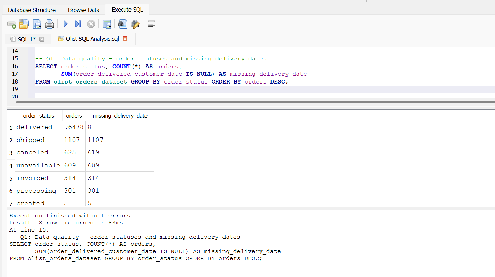
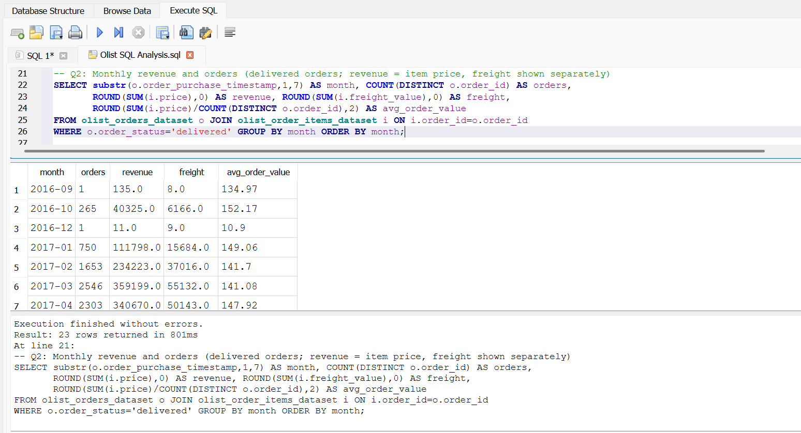
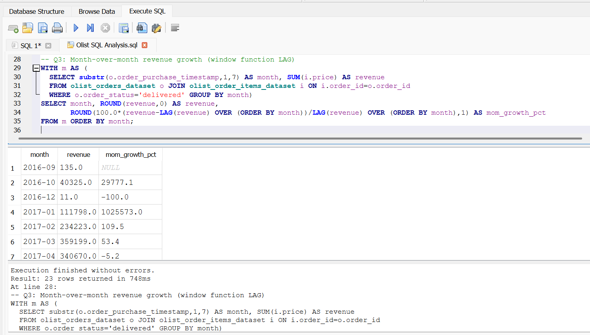
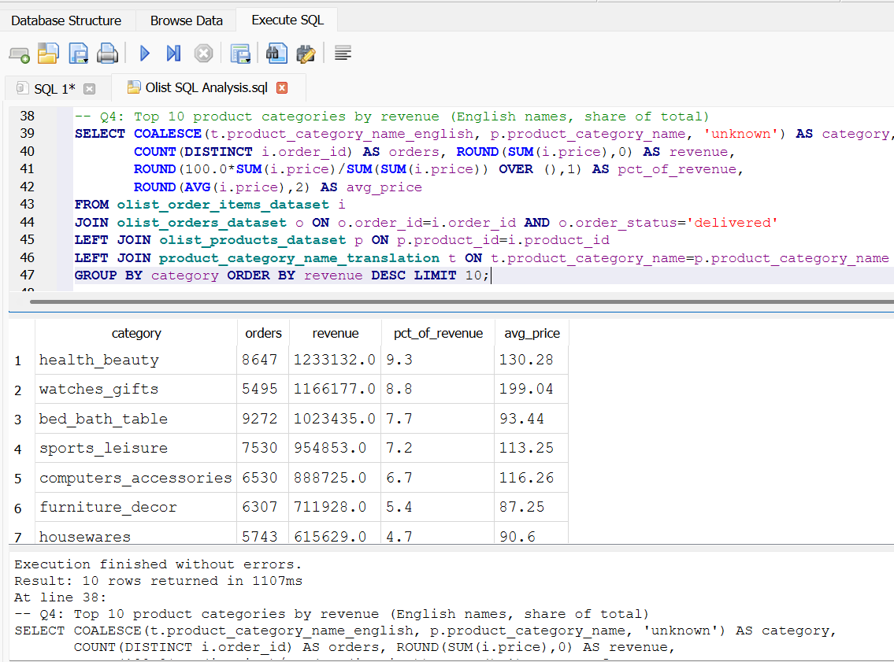
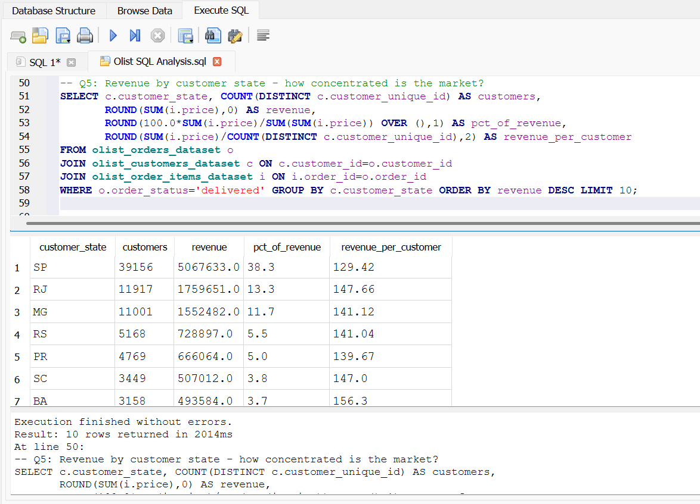
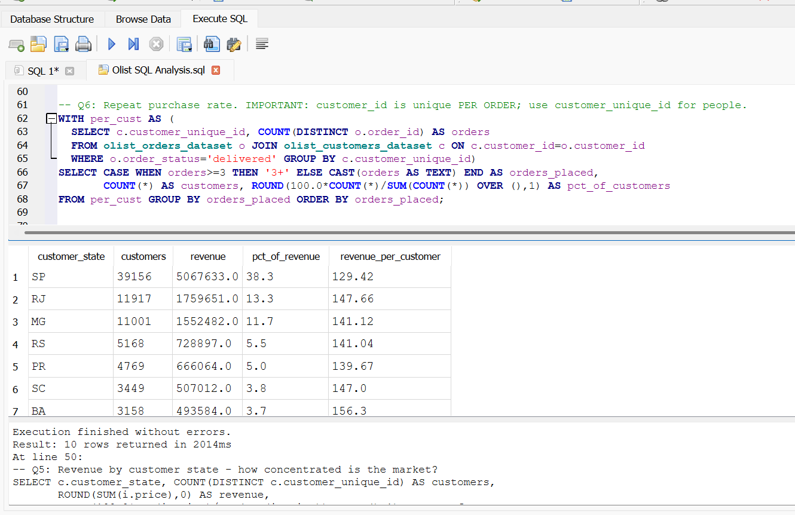
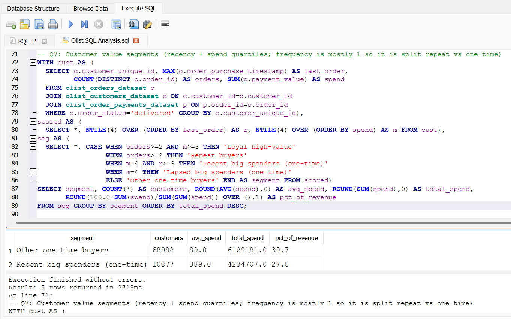
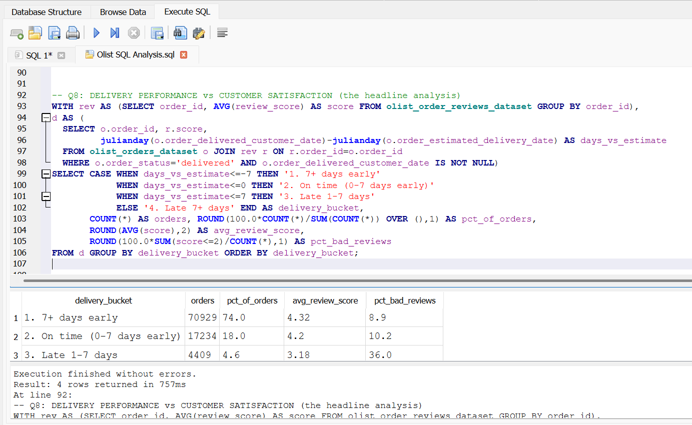
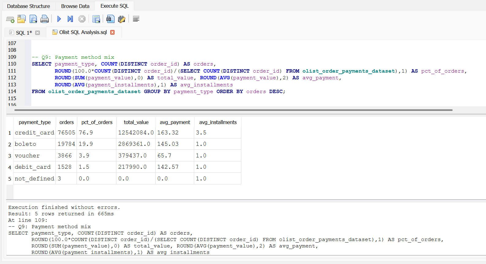
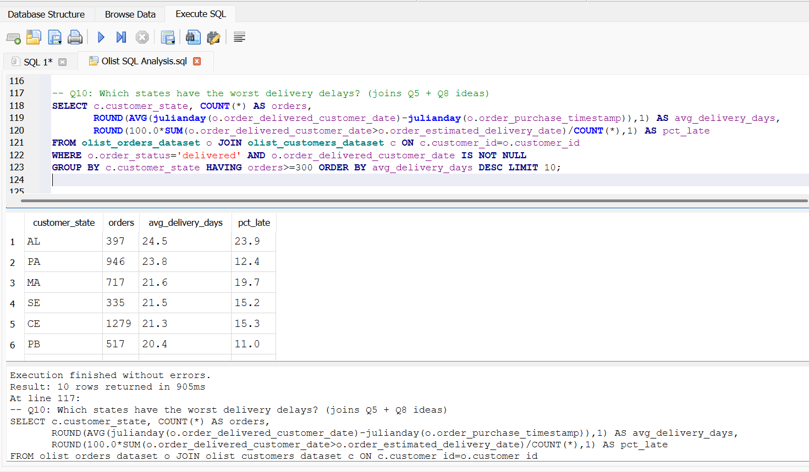

# Olist E-Commerce Analysis: Growth, Customer Retention and the Cost of Late Deliveries

**Business question:** Olist is a Brazilian online marketplace. Where is its revenue coming from, are customers coming back, and how much does delivery performance affect customer satisfaction?

**Tools:** SQL (SQLite, DB Browser for SQLite). Techniques: joins across 6 tables, CTEs, window functions (`LAG`, `NTILE`, `SUM() OVER`), conditional aggregation, date arithmetic.
**Data:** [Olist Brazilian E-Commerce Public Dataset](https://www.kaggle.com/datasets/olistbr/brazilian-ecommerce) (Kaggle), about 100K orders from 2016 to 2018.

## Key findings

### 1. Late deliveries are the biggest driver of bad reviews
Orders were grouped by how delivery compared with the estimated date:

| Delivery vs. estimate | Orders | % of orders | Avg review score | % bad reviews (1-2 stars) |
|---|---|---|---|---|
| 7+ days early | 70,929 | 74.0% | 4.32 | 8.9% |
| On time (0-7 days early) | 17,234 | 18.0% | 4.20 | 10.2% |
| Late 1-7 days | 4,409 | 4.6% | 3.18 | 36.0% |
| Late 7+ days | 3,252 | 3.4% | 1.73 | 78.3% |

- Only about **8% of orders arrive late**, but those orders produce roughly **one third of all bad reviews**.
- Even a delay of 1-7 days drops the average score by about a full point, and a delay of over a week leaves almost 4 in 5 customers dissatisfied.
- **Recommendation:** treat late deliveries as a priority. Improve delivery estimates (add a buffer where carriers are unreliable) and contact customers proactively when an order is running late.

### 2. Rapid growth in 2017, then a plateau in 2018
- Monthly revenue grew from about **$112K (Jan 2017)** to **$925K (Jan 2018)**. Revenue for 2017 was about **$5.96M**.
- Jan-Aug 2018 revenue was already about **$7.22M**, more than the whole of 2017 and about 2.4x the same months of 2017.
- November 2017 was the peak month at **$988K from 7,289 orders**, likely driven by Black Friday promotions.
- Since early 2018, monthly revenue has been **flat at roughly $825K-$980K**. The business stopped growing month over month, which is worth investigating.
- Average order value is stable at about **$125-$150**, so growth came from more orders, not bigger baskets.
- **Recommendation:** with growth flattening, retention and basket size matter more than before (see finding 3).

### 3. Almost no customers come back
Of 93,358 customers with a delivered order:

| Orders placed | Customers | % of customers |
|---|---|---|
| 1 | 90,557 | 97.0% |
| 2 | 2,573 | 2.8% |
| 3+ | 228 | 0.2% |

- Only **about 3% of customers ordered more than once**. The marketplace depends almost entirely on acquiring new customers.
- Combined with finding 1, a customer's first delivery experience matters a great deal, because for most customers it's the only experience they will have.
- **Recommendation:** test post-purchase email campaigns and loyalty incentives, starting with customers who gave 4-5 star reviews.

### 4. Revenue is spread across categories, with different business models
- The top 3 categories (**health_beauty, watches_gifts, bed_bath_table**) account for **25.8%** of revenue, and the top 10 for **62.4%**.
- **bed_bath_table** has the most orders (9,272) but a low average item price (about $93), while **watches_gifts** earns almost as much revenue from far fewer orders (5,495) at about **$199 per item**.
- **Recommendation:** high-ticket categories (watches_gifts, cool_stuff at about $164) earn more per order and are worth prioritizing in marketing, while high-volume low-price categories are better suited to bundling and cross-selling.

### 5. The market is concentrated in the Southeast
| State | Customers | Revenue | % of revenue | Revenue per customer |
|---|---|---|---|---|
| SP (São Paulo) | 39,156 | $5.07M | 38.3% | $129 |
| RJ (Rio de Janeiro) | 11,917 | $1.76M | 13.3% | $148 |
| MG (Minas Gerais) | 11,001 | $1.55M | 11.7% | $141 |
| RS | 5,168 | $0.73M | 5.5% | $141 |
| PR | 4,769 | $0.67M | 5.0% | $140 |

- **Three states (SP, RJ, MG) generate 63% of revenue**, and the top 10 states generate about 88%.
- São Paulo has the most customers but the **lowest revenue per customer ($129)** among the top states. Smaller or more remote states such as Bahia (BA, $156) and Goiás (GO, $149) spend more per customer.
- **Recommendation:** São Paulo is a volume market, so focus on retention and basket size there. Higher-spending states may justify targeted marketing, but check their delivery times first (see Q10) because remote states may have longer waits.

### 6. Credit cards dominate payments, and cards are used with installments
| Payment type | Orders | % of orders | Avg payment | Avg installments |
|---|---|---|---|---|
| Credit card | 76,505 | 76.9% | $163 | 3.5 |
| Boleto (bank slip) | 19,784 | 19.9% | $145 | 1.0 |
| Voucher | 3,866 | 3.9% | $66 | 1.0 |
| Debit card | 1,528 | 1.5% | $143 | 1.0 |

- Credit cards account for about **77% of orders** and the largest payments, with an average of **3.5 installments**. Installment payments are common in Brazil and make larger purchases easier for customers.
- **Boleto is about 20% of orders.** It is a payment method that needs the customer to pay before the order is released, so it can add friction and delay.
- **Recommendation:** keep installment options prominent at checkout, and test reminders for unpaid boleto orders.

---

## Caveats
- **Revenue** here is the item price of delivered orders and excludes freight. Freight adds roughly 14-18% on top.
- Late 2016 months have only a handful of orders, so they are excluded from trend conclusions.
- The delivery vs. review analysis shows an association, not proof of cause. Late orders may also involve problem sellers or products. Only orders with a review are included.
- Customers are identified by `customer_unique_id`. Olist's `customer_id` changes with every order, so using it would wrongly show nearly 100% one-time customers.
- "Bad review" is defined as a score of 1 or 2.
- Payment percentages add up to slightly more than 100% because some orders are paid with more than one method (for example, a card plus a voucher).
- "Revenue per customer" by state uses item price only, and counts a customer once per state.

## Files
| File | Purpose |
|---|---|
| `Olist SQL Analysis.sql` | All analysis queries (Q1-Q10) |
| `q01_...png` to `q10_...png` | Screenshot of each query's result |

## How to reproduce
1. Download the [dataset from Kaggle](https://www.kaggle.com/datasets/olistbr/brazilian-ecommerce).
2. In DB Browser for SQLite, create a new database and import the 7 CSV files used here, one table per file.
3. Run the queries in `Olist SQL Analysis.sql` in order.

---

# Query-by-query results

## Q1: Data quality - order statuses and missing delivery dates

### Business question
Before analysing anything: what statuses do orders have, and how many are missing a delivery date?

### SQL
```sql
SELECT order_status, COUNT(*) AS orders,
       SUM(order_delivered_customer_date IS NULL) AS missing_delivery_date
FROM olist_orders_dataset GROUP BY order_status ORDER BY orders DESC;
```

### Result
*Result table: see screenshot.*



### What it shows
- This query counts orders by status and how many of them have no delivery date. It is the data-quality check that justifies filtering revenue and delivery analyses to `delivered` orders.

### Caveats
- Revenue and delivery analyses in this project use delivered orders only.

---

## Q2: Monthly revenue and orders (delivered orders; revenue = item price, freight shown separately)

### Business question
How have orders and revenue changed month by month, and is growth coming from more orders or bigger baskets?

### SQL
```sql
SELECT substr(o.order_purchase_timestamp,1,7) AS month, COUNT(DISTINCT o.order_id) AS orders,
       ROUND(SUM(i.price),0) AS revenue, ROUND(SUM(i.freight_value),0) AS freight,
       ROUND(SUM(i.price)/COUNT(DISTINCT o.order_id),2) AS avg_order_value
FROM olist_orders_dataset o JOIN olist_order_items_dataset i ON i.order_id=o.order_id
WHERE o.order_status='delivered' GROUP BY month ORDER BY month;
```

### Result
| Month | Orders | Revenue | Freight | Avg order value |
|---|---|---|---|---|
| 2016-09 | 1 | $135 | $8 | $134.97 |
| 2016-10 | 265 | $40,325 | $6,166 | $152.17 |
| 2016-12 | 1 | $11 | $9 | $10.90 |
| 2017-01 | 750 | $111,798 | $15,684 | $149.06 |
| 2017-02 | 1,653 | $234,223 | $37,016 | $141.70 |
| 2017-03 | 2,546 | $359,199 | $55,132 | $141.08 |
| 2017-04 | 2,303 | $340,670 | $50,143 | $147.92 |
| 2017-05 | 3,546 | $489,338 | $77,513 | $138.00 |
| 2017-06 | 3,135 | $421,923 | $68,127 | $134.58 |
| 2017-07 | 3,872 | $481,605 | $84,695 | $124.38 |
| 2017-08 | 4,193 | $554,700 | $91,133 | $132.29 |
| 2017-09 | 4,150 | $607,400 | $93,678 | $146.36 |
| 2017-10 | 4,478 | $648,248 | $102,869 | $144.76 |
| 2017-11 | 7,289 | $987,765 | $165,599 | $135.51 |
| 2017-12 | 5,513 | $726,033 | $117,045 | $131.69 |
| 2018-01 | 7,069 | $924,645 | $153,242 | $130.80 |
| 2018-02 | 6,555 | $826,437 | $139,731 | $126.08 |
| 2018-03 | 7,003 | $953,356 | $167,242 | $136.14 |
| 2018-04 | 6,798 | $973,534 | $159,345 | $143.21 |
| 2018-05 | 6,749 | $977,545 | $151,230 | $144.84 |
| 2018-06 | 6,099 | $856,078 | $155,900 | $140.36 |
| 2018-07 | 6,159 | $867,953 | $159,854 | $140.92 |
| 2018-08 | 6,351 | $838,577 | $146,915 | $132.04 |



### What it shows
- Revenue grew from **$112K (Jan 2017)** to **$925K (Jan 2018)**.
- Peak month was **November 2017: $988K from 7,289 orders**, likely Black Friday.
- From early 2018 revenue is **flat at roughly $825K-$980K a month**: growth has stalled.
- Average order value stays in a narrow **$125-$150** band, so growth came from **more orders, not bigger baskets**.

### Caveats
- Late 2016 months have only a handful of orders (Sept 2016: 1 order) and are not meaningful for trends.
- Revenue is item price only. Freight is shown separately.
- Data ends in August 2018.

---

## Q3: Month-over-month revenue growth (window function LAG)

### Business question
How fast is revenue growing month over month, and when did growth change?

### SQL
```sql
WITH m AS (
  SELECT substr(o.order_purchase_timestamp,1,7) AS month, SUM(i.price) AS revenue
  FROM olist_orders_dataset o JOIN olist_order_items_dataset i ON i.order_id=o.order_id
  WHERE o.order_status='delivered' GROUP BY month)
SELECT month, ROUND(revenue,0) AS revenue,
       ROUND(100.0*(revenue-LAG(revenue) OVER (ORDER BY month))/LAG(revenue) OVER (ORDER BY month),1) AS mom_growth_pct
FROM m ORDER BY month;
```

### Result
| Month | Revenue | MoM growth |
|---|---|---|
| 2017-01 | $111,798 |  |
| 2017-02 | $234,223 | +109.5% |
| 2017-03 | $359,199 | +53.4% |
| 2017-04 | $340,670 | -5.2% |
| 2017-05 | $489,338 | +43.6% |
| 2017-06 | $421,923 | -13.8% |
| 2017-07 | $481,605 | +14.1% |
| 2017-08 | $554,700 | +15.2% |
| 2017-09 | $607,400 | +9.5% |
| 2017-10 | $648,248 | +6.7% |
| 2017-11 | $987,765 | +52.4% |
| 2017-12 | $726,033 | -26.5% |
| 2018-01 | $924,645 | +27.4% |
| 2018-02 | $826,437 | -10.6% |
| 2018-03 | $953,356 | +15.4% |
| 2018-04 | $973,534 | +2.1% |
| 2018-05 | $977,545 | +0.4% |
| 2018-06 | $856,078 | -12.4% |
| 2018-07 | $867,953 | +1.4% |
| 2018-08 | $838,577 | -3.4% |

*Computed from the Q2 results. Your Q3 output should match these numbers (it also includes the 2016 months).*



### What it shows
- Biggest monthly jump: **2017-02 (+109.5%)**. Biggest drop: **2017-12 (-26.5%)**.
- Growth was strong through 2017, with a Black Friday spike in November followed by a December fall.
- In 2018 month-over-month changes are small and mixed, confirming the plateau seen in Q2.

### Caveats
- Month-over-month changes on small early-2017 numbers look large in percentage terms because the base is small.
- The first row of each series has no previous month, so growth is blank.

---

## Q4: Top 10 product categories by revenue (English names, share of total)

### Business question
Which product categories earn the most revenue, and how do their prices differ?

### SQL
```sql
SELECT COALESCE(t.product_category_name_english, p.product_category_name, 'unknown') AS category,
       COUNT(DISTINCT i.order_id) AS orders, ROUND(SUM(i.price),0) AS revenue,
       ROUND(100.0*SUM(i.price)/SUM(SUM(i.price)) OVER (),1) AS pct_of_revenue,
       ROUND(AVG(i.price),2) AS avg_price
FROM olist_order_items_dataset i
JOIN olist_orders_dataset o ON o.order_id=i.order_id AND o.order_status='delivered'
LEFT JOIN olist_products_dataset p ON p.product_id=i.product_id
LEFT JOIN product_category_name_translation t ON t.product_category_name=p.product_category_name
GROUP BY category ORDER BY revenue DESC LIMIT 10;
```

### Result
| Category | Orders | Revenue | % of revenue | Avg item price |
|---|---|---|---|---|
| health_beauty | 8,647 | $1,233,132 | 9.3% | $130.28 |
| watches_gifts | 5,495 | $1,166,177 | 8.8% | $199.04 |
| bed_bath_table | 9,272 | $1,023,435 | 7.7% | $93.44 |
| sports_leisure | 7,530 | $954,853 | 7.2% | $113.25 |
| computers_accessories | 6,530 | $888,725 | 6.7% | $116.26 |
| furniture_decor | 6,307 | $711,928 | 5.4% | $87.25 |
| housewares | 5,743 | $615,629 | 4.7% | $90.60 |
| cool_stuff | 3,559 | $610,204 | 4.6% | $164.12 |
| auto | 3,810 | $578,967 | 4.4% | $139.85 |
| toys | 3,804 | $471,286 | 3.6% | $116.94 |



### What it shows
- The top 3 categories earn **25.8%** of revenue and the top 10 earn **62.4%**: no single category dominates.
- **bed_bath_table** has the most orders (9,272) but a low average price (about $93).
- **watches_gifts** earns almost as much revenue from far fewer orders (5,495) because items average **$199**.
- High-ticket categories (watches_gifts, cool_stuff at $164) earn more per order.

### Caveats
- Categories are shown in English via the translation table. Products with no category fall into 'unknown' or the original Portuguese name.
- Only the top 10 are shown (LIMIT 10).

---

## Q5: Revenue by customer state - how concentrated is the market?

### Business question
Where do customers and revenue come from geographically?

### SQL
```sql
SELECT c.customer_state, COUNT(DISTINCT c.customer_unique_id) AS customers,
       ROUND(SUM(i.price),0) AS revenue,
       ROUND(100.0*SUM(i.price)/SUM(SUM(i.price)) OVER (),1) AS pct_of_revenue,
       ROUND(SUM(i.price)/COUNT(DISTINCT c.customer_unique_id),2) AS revenue_per_customer
FROM olist_orders_dataset o
JOIN olist_customers_dataset c ON c.customer_id=o.customer_id
JOIN olist_order_items_dataset i ON i.order_id=o.order_id
WHERE o.order_status='delivered' GROUP BY c.customer_state ORDER BY revenue DESC LIMIT 10;
```

### Result
| State | Customers | Revenue | % of revenue | Revenue per customer |
|---|---|---|---|---|
| SP | 39,156 | $5,067,633 | 38.3% | $129.42 |
| RJ | 11,917 | $1,759,651 | 13.3% | $147.66 |
| MG | 11,001 | $1,552,482 | 11.7% | $141.12 |
| RS | 5,168 | $728,897 | 5.5% | $141.04 |
| PR | 4,769 | $666,064 | 5.0% | $139.67 |
| SC | 3,449 | $507,012 | 3.8% | $147.00 |
| BA | 3,158 | $493,584 | 3.7% | $156.30 |
| DF | 2,019 | $296,498 | 2.2% | $146.85 |
| GO | 1,895 | $282,837 | 2.1% | $149.25 |
| ES | 1,928 | $268,643 | 2.0% | $139.34 |



### What it shows
- **SP, RJ and MG generate 63%** of revenue; the top 10 states generate about **88%**.
- São Paulo has the most customers but the **lowest revenue per customer ($129)** of the top states.
- Smaller states such as BA ($156) and GO ($149) spend more per customer.

### Caveats
- Customers are counted with `customer_unique_id`, once per state.
- Revenue is item price of delivered orders.

---

## Q6: Repeat purchase rate. IMPORTANT: customer_id is unique PER ORDER; use customer_unique_id for people.

### Business question
How many customers come back and order again?

### SQL
```sql
WITH per_cust AS (
  SELECT c.customer_unique_id, COUNT(DISTINCT o.order_id) AS orders
  FROM olist_orders_dataset o JOIN olist_customers_dataset c ON c.customer_id=o.customer_id
  WHERE o.order_status='delivered' GROUP BY c.customer_unique_id)
SELECT CASE WHEN orders>=3 THEN '3+' ELSE CAST(orders AS TEXT) END AS orders_placed,
       COUNT(*) AS customers, ROUND(100.0*COUNT(*)/SUM(COUNT(*)) OVER (),1) AS pct_of_customers
FROM per_cust GROUP BY orders_placed ORDER BY orders_placed;
```

### Result
| Orders placed | Customers | % of customers |
|---|---|---|
| 1 | 90,557 | 97.0% |
| 2 | 2,573 | 2.8% |
| 3+ | 228 | 0.2% |



### What it shows
- **97% of customers ordered once.** Only about 3% came back.
- The marketplace relies almost entirely on winning new customers, so each customer's first experience matters (see Q8).
- Retention is the biggest untapped opportunity.

### Caveats
- `customer_id` in Olist changes with every order, so repeat buyers must be identified with `customer_unique_id`. Using `customer_id` would wrongly show almost 100% one-time customers.
- The dataset covers about two years, so some customers may return after the data ends.

---

## Q7: Customer value segments (recency + spend quartiles; frequency is mostly 1 so it is split repeat vs one-time)

### Business question
Which customer groups are most valuable, given that nearly everyone buys only once?

### SQL
```sql
WITH cust AS (
  SELECT c.customer_unique_id, MAX(o.order_purchase_timestamp) AS last_order,
         COUNT(DISTINCT o.order_id) AS orders, SUM(p.payment_value) AS spend
  FROM olist_orders_dataset o
  JOIN olist_customers_dataset c ON c.customer_id=o.customer_id
  JOIN olist_order_payments_dataset p ON p.order_id=o.order_id
  WHERE o.order_status='delivered' GROUP BY c.customer_unique_id),
scored AS (
  SELECT *, NTILE(4) OVER (ORDER BY last_order) AS r, NTILE(4) OVER (ORDER BY spend) AS m FROM cust),
seg AS (
  SELECT *, CASE WHEN orders>=2 AND m>=3 THEN 'Loyal high-value'
                 WHEN orders>=2 THEN 'Repeat buyers'
                 WHEN m=4 AND r>=3 THEN 'Recent big spenders (one-time)'
                 WHEN m=4 THEN 'Lapsed big spenders (one-time)'
                 ELSE 'Other one-time buyers' END AS segment FROM scored)
SELECT segment, COUNT(*) AS customers, ROUND(AVG(spend),0) AS avg_spend, ROUND(SUM(spend),0) AS total_spend,
       ROUND(100.0*SUM(spend)/SUM(SUM(spend)) OVER (),1) AS pct_of_revenue
FROM seg GROUP BY segment ORDER BY total_spend DESC;
```

### Result
*Result table: see screenshot.*



### What it shows
- Customers are grouped into value segments using spend and recency, with repeat vs one-time buyers separated because almost all customers order only once (see Q6). The screenshot shows the number of customers, average spend and share of revenue in each segment.

### Caveats
- Because frequency is almost always 1, the usual RFM scoring is simplified here to repeat vs one-time buyers combined with spend and recency.
- Spend uses payment value, which includes freight, so it differs from the item-price revenue in other queries.

---

## Q8: DELIVERY PERFORMANCE vs CUSTOMER SATISFACTION (the headline analysis)

### Business question
Does late delivery hurt customer satisfaction?

### SQL
```sql
WITH rev AS (SELECT order_id, AVG(review_score) AS score FROM olist_order_reviews_dataset GROUP BY order_id),
d AS (
  SELECT o.order_id, r.score,
         julianday(o.order_delivered_customer_date)-julianday(o.order_estimated_delivery_date) AS days_vs_estimate
  FROM olist_orders_dataset o JOIN rev r ON r.order_id=o.order_id
  WHERE o.order_status='delivered' AND o.order_delivered_customer_date IS NOT NULL)
SELECT CASE WHEN days_vs_estimate<=-7 THEN '1. 7+ days early'
            WHEN days_vs_estimate<=0 THEN '2. On time (0-7 days early)'
            WHEN days_vs_estimate<=7 THEN '3. Late 1-7 days'
            ELSE '4. Late 7+ days' END AS delivery_bucket,
       COUNT(*) AS orders, ROUND(100.0*COUNT(*)/SUM(COUNT(*)) OVER (),1) AS pct_of_orders,
       ROUND(AVG(score),2) AS avg_review_score,
       ROUND(100.0*SUM(score<=2)/COUNT(*),1) AS pct_bad_reviews
FROM d GROUP BY delivery_bucket ORDER BY delivery_bucket;
```

### Result
| Delivery vs estimate | Orders | % of orders | Avg review score | % bad reviews (1-2 stars) |
|---|---|---|---|---|
| 7+ days early | 70,929 | 74.0% | 4.32 | 8.9% |
| On time (0-7 days early) | 17,234 | 18.0% | 4.20 | 10.2% |
| Late 1-7 days | 4,409 | 4.6% | 3.18 | 36.0% |
| Late 7+ days | 3,252 | 3.4% | 1.73 | 78.3% |



### What it shows
- **Late orders cut review scores sharply:** from about 4.2-4.3 for on-time orders to 3.18 for 1-7 days late and **1.73** for over a week late.
- Just 8% of orders arrive late, yet they produce about a third of all bad reviews.
- **This is the headline finding of the project.** Recommendation: improve delivery estimates and contact customers proactively when an order is late.

### Caveats
- This shows an association, not proof of cause: late orders may also involve problem sellers or products.
- Only orders with a review and a delivery date are included. 'Bad review' means a score of 1 or 2.

---

## Q9: Payment method mix

### Business question
How do customers pay, and how do payment types differ in size?

### SQL
```sql
SELECT payment_type, COUNT(DISTINCT order_id) AS orders,
       ROUND(100.0*COUNT(DISTINCT order_id)/(SELECT COUNT(DISTINCT order_id) FROM olist_order_payments_dataset),1) AS pct_of_orders,
       ROUND(SUM(payment_value),0) AS total_value, ROUND(AVG(payment_value),2) AS avg_payment,
       ROUND(AVG(payment_installments),1) AS avg_installments
FROM olist_order_payments_dataset GROUP BY payment_type ORDER BY orders DESC;
```

### Result
| Payment type | Orders | % of orders | Total value | Avg payment | Avg installments |
|---|---|---|---|---|---|
| credit_card | 76,505 | 76.9% | $12,542,084 | $163.32 | 3.5 |
| boleto | 19,784 | 19.9% | $2,869,361 | $145.03 | 1.0 |
| voucher | 3,866 | 3.9% | $379,437 | $65.70 | 1.0 |
| debit_card | 1,528 | 1.5% | $217,990 | $142.57 | 1.0 |
| not_defined | 3 | 0.0% | $0 | $0 | 1.0 |



### What it shows
- **Credit cards make up about 77% of orders** and the largest payments, with an average of **3.5 installments**.
- **Boleto (bank slip) is about 20% of orders**, and requires the customer to pay before the order is released.
- Vouchers are small payments (about $66), usually combined with another method.
- Recommendation: keep installment options prominent at checkout and test payment reminders for unpaid boleto orders.

### Caveats
- Percentages add up to slightly more than 100% because some orders use more than one payment method.
- The 3 'not_defined' rows have zero value and can be ignored.

---

## Q10: Which states have the worst delivery delays? (joins Q5 + Q8 ideas)

### Business question
Which states wait longest for delivery, and where are late deliveries most common?

### SQL
```sql
SELECT c.customer_state, COUNT(*) AS orders,
       ROUND(AVG(julianday(o.order_delivered_customer_date)-julianday(o.order_purchase_timestamp)),1) AS avg_delivery_days,
       ROUND(100.0*SUM(o.order_delivered_customer_date>o.order_estimated_delivery_date)/COUNT(*),1) AS pct_late
FROM olist_orders_dataset o JOIN olist_customers_dataset c ON c.customer_id=o.customer_id
WHERE o.order_status='delivered' AND o.order_delivered_customer_date IS NOT NULL
GROUP BY c.customer_state HAVING orders>=300 ORDER BY avg_delivery_days DESC LIMIT 10;
```

### Result
*Result table: see screenshot.*



### What it shows
- For each state with at least 300 delivered orders, the query shows average delivery time in days and the percentage of orders delivered after the estimated date. It extends the Q8 finding by showing where late deliveries are most common.

### Caveats
- Delivery days are measured from purchase to delivery to the customer.
- 'Late' means delivered after the estimated delivery date.
